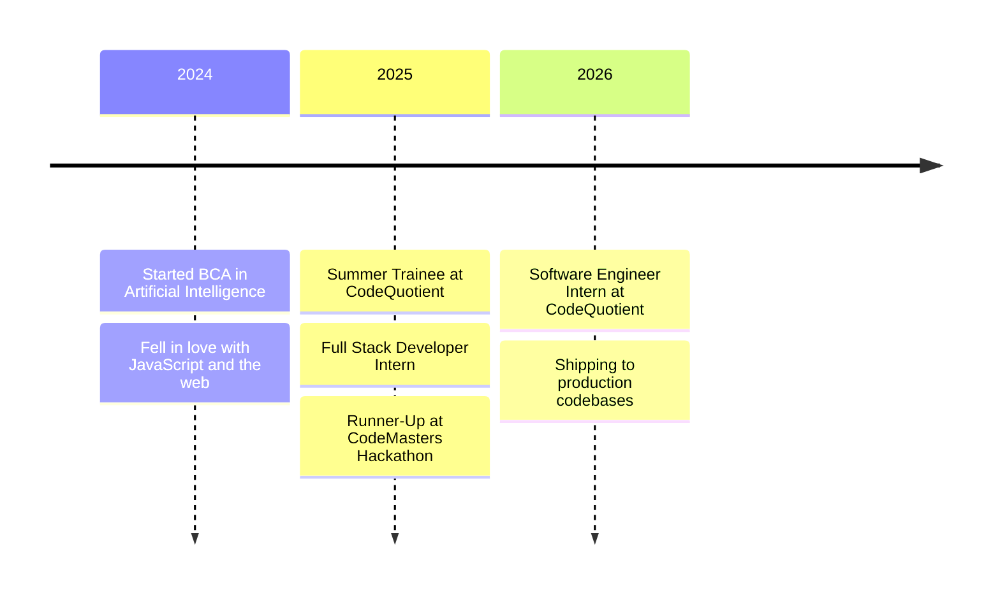

<!-- ═══════════════════════════════ HEADER ═══════════════════════════════ -->

  

  

  
  
  
  

  
  
  

<!-- ═══════════════════════════════ ABOUT ═══════════════════════════════ -->

## 👨‍💻 About Me

  <picture>
    <source media="(prefers-color-scheme: dark)" srcset="./assets/terminal-dark.svg" />
    <source media="(prefers-color-scheme: light)" srcset="./assets/terminal-light.svg" />
    
  </picture>

I'm a **full-stack software engineer** who builds products end to end — from responsive, motion-rich interfaces to backend systems designed to stay fast and reliable under load. I'm currently a **Software Engineer Intern at CodeQuotient**, shipping features across production codebases, and pursuing a **BCA in Artificial Intelligence**.

I work best where **product thinking meets engineering depth**: understanding the problem first, choosing the simplest architecture that scales, and sweating the details users actually feel.

<table>
  <tr>
    <td width="50%" valign="top">
      <h4>⚙️ What I do</h4>
      <ul>
        <li>Full-stack web apps with <b>React</b> &amp; <b>Node.js</b></li>
        <li>Real-time features with <b>Socket.IO</b></li>
        <li>Async pipelines with <b>BullMQ</b> &amp; <b>Redis</b></li>
        <li>Secure auth — <b>JWT</b>, <b>OAuth 2.0</b>, <b>RBAC</b></li>
      </ul>
    </td>
    <td width="50%" valign="top">
      <h4>🌱 What I'm deepening</h4>
      <ul>
        <li>System design &amp; scalability</li>
        <li>Event-driven architecture</li>
        <li>Docker &amp; cloud deployment</li>
        <li>Clean, testable code at scale</li>
      </ul>
    </td>
  </tr>
  <tr>
    <td width="50%" valign="top">
      <h4>💬 Ask me about</h4>
      React · Node.js · Redis · Socket.IO · BullMQ · MongoDB · PostgreSQL · REST API design
    </td>
    <td width="50%" valign="top">
      <h4>🤝 Open to</h4>
      <b>Software Engineering roles</b>, open-source, and hackathons. <a href="mailto:chatentoor009@gmail.com"><b>Let's talk →</b></a>
    </td>
  </tr>
</table>

<b>🧭 My journey</b> &nbsp;click to expand

 

<b>🏆 Highlights</b> &nbsp;click to expand

 

| | Highlight |
|:--:|:--|
| 🥈 | **Runner-Up — CodeMasters 2025 Hackathon** · algorithmic challenges solved without built-in library functions |
| 📜 | **HackerRank Certified** · Problem Solving (Intermediate) · REST API (Intermediate) · Software Engineer Intern |
| 🎓 | **Industrial Training Certification** · CodeQuotient — full-stack &amp; backend systems |

<b>💡 How I work</b> &nbsp;click to expand

 

- **Understand before building** — read the existing code and ask *why* before writing a line.
- **Document decisions** — trade-offs go into Architecture Decision Records (ADRs).
- **Validate before handoff** — every fix is tested, not just "works on my machine".
- **Small, reviewable changes** — easy to review, easy to revert, easy to trust.
- **Sweat the details** — loading, empty and error states, and a smooth 60fps scroll.

<b>🎯 2026 goals</b> &nbsp;click to expand

 

- [x] Ship an AI-powered SaaS end to end
- [x] Work in real production codebases
- [ ] Make meaningful open-source contributions
- [ ] Go deeper into distributed systems &amp; system design
- [ ] Land a full-time Software Engineer role

<!-- ═══════════════════════════════ STACK ═══════════════════════════════ -->

## 🛠️ Tech Stack

<table align="center">
  <tr>
    <td align="right"><b>Languages</b></td>
    <td></td>
  </tr>
  <tr>
    <td align="right"><b>Frontend</b></td>
    <td></td>
  </tr>
  <tr>
    <td align="right"><b>Backend</b></td>
    <td></td>
  </tr>
  <tr>
    <td align="right"><b>Data &amp; Cache</b></td>
    <td></td>
  </tr>
  <tr>
    <td align="right"><b>Cloud &amp; Tools</b></td>
    <td></td>
  </tr>
</table>

  
  
  
  
  
  
  
  

<!-- ═══════════════════════════════ ACTIVITY ═══════════════════════════════ -->

## 📈 GitHub Activity

  <picture>
    <source media="(prefers-color-scheme: dark)" srcset="https://streak-stats.demolab.com/?user=chaten99&theme=github-dark-blue&hide_border=true&background=0D1117&ring=8C8AFF&fire=38E8FF&currStreakLabel=8C8AFF&sideLabels=C9D1D9&dates=7D8590" />
    <source media="(prefers-color-scheme: light)" srcset="https://streak-stats.demolab.com/?user=chaten99&theme=default&hide_border=true&background=FFFFFF&ring=5257FF&fire=8C8AFF&currStreakLabel=5257FF" />
    
  </picture>

  

  <picture>
    <source media="(prefers-color-scheme: dark)" srcset="https://raw.githubusercontent.com/chaten99/chaten99/output/github-snake-dark.svg" />
    <source media="(prefers-color-scheme: light)" srcset="https://raw.githubusercontent.com/chaten99/chaten99/output/github-snake.svg" />
    
  </picture>

<!-- ═══════════════════════════════ FOOTER ═══════════════════════════════ -->

<b>😄 Dev joke of the moment</b> &nbsp;refresh for a new one

 

  

 

  <b>Have an idea, an opportunity, or just want to talk tech?</b> 
  <a href="mailto:chatentoor009@gmail.com">chatentoor009@gmail.com</a> &nbsp;·&nbsp; <a href="https://chaten.in"><b>chaten.in</b></a> &nbsp;·&nbsp; <a href="https://www.linkedin.com/in/chaten/">LinkedIn</a>

  

